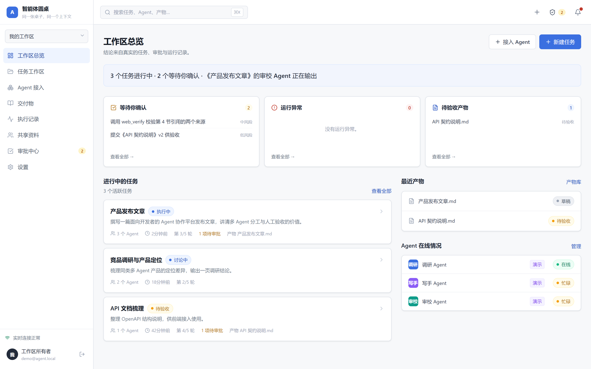
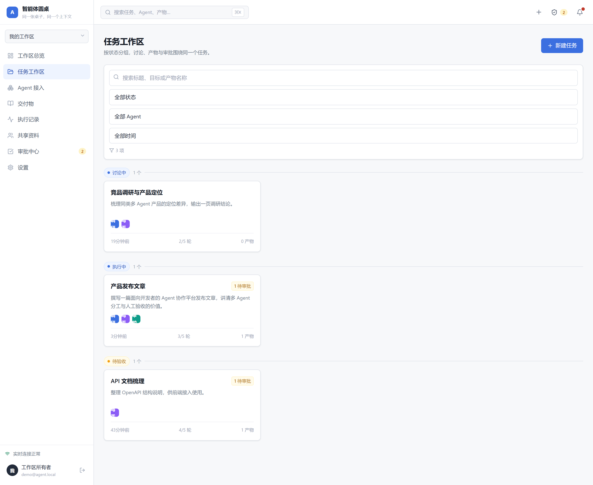
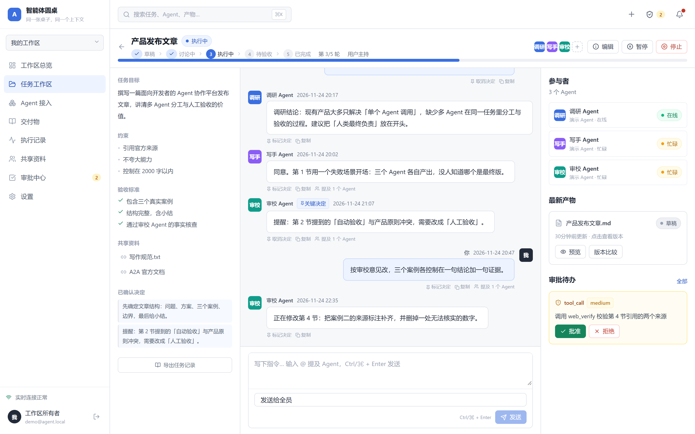
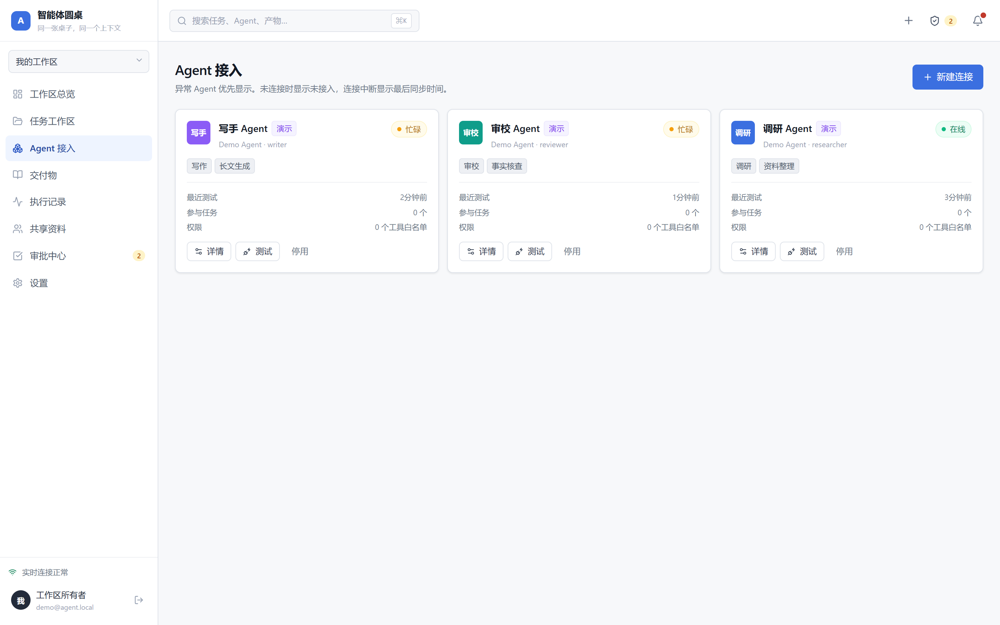
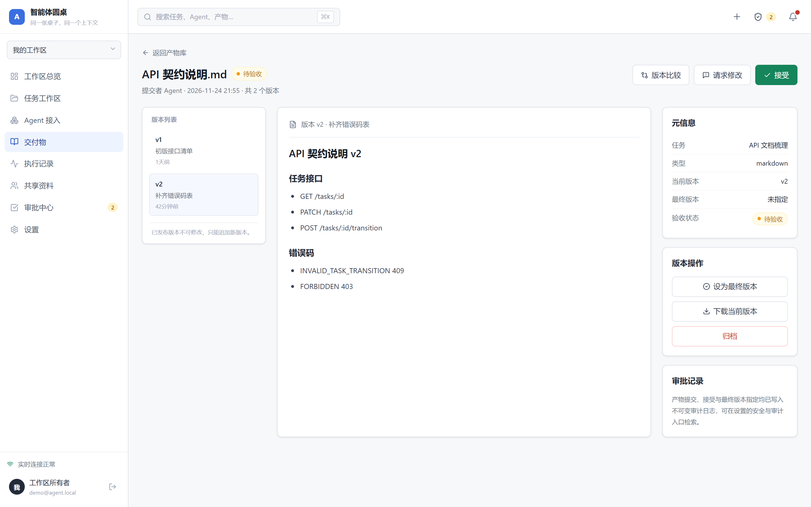
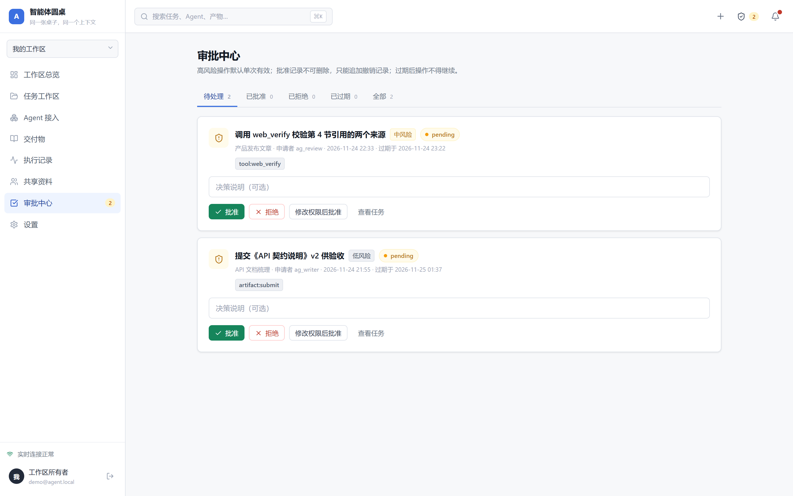
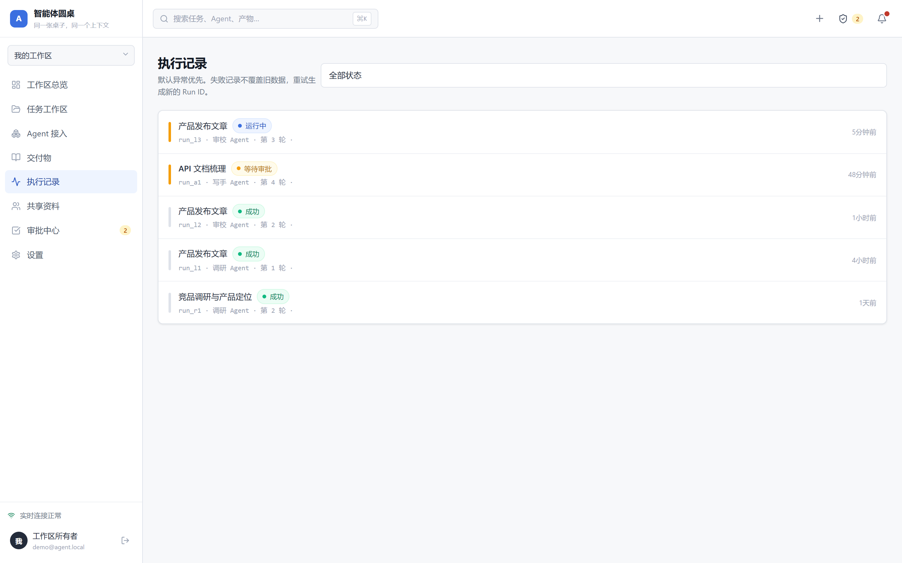
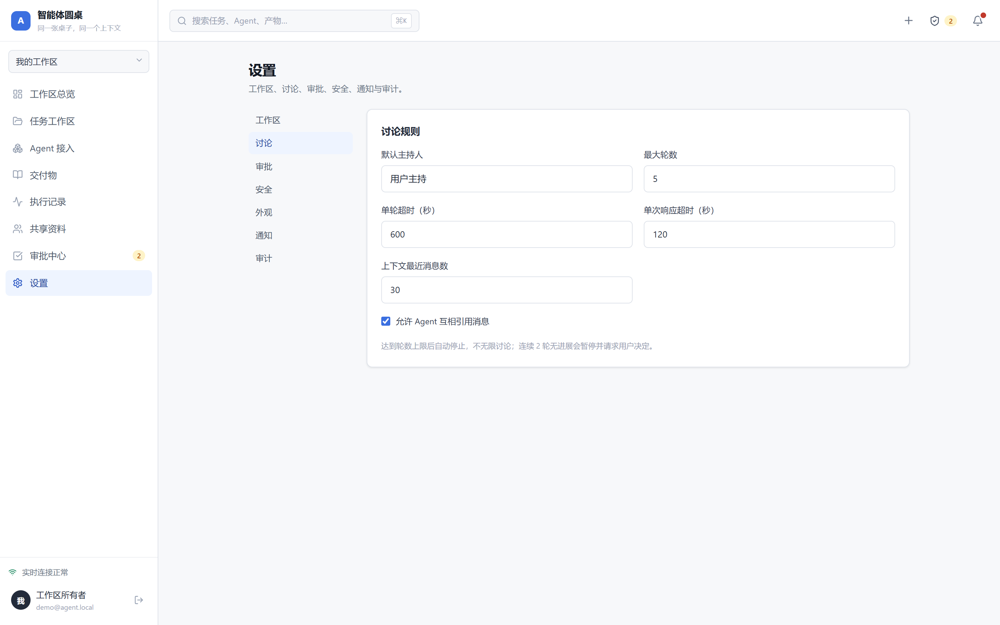
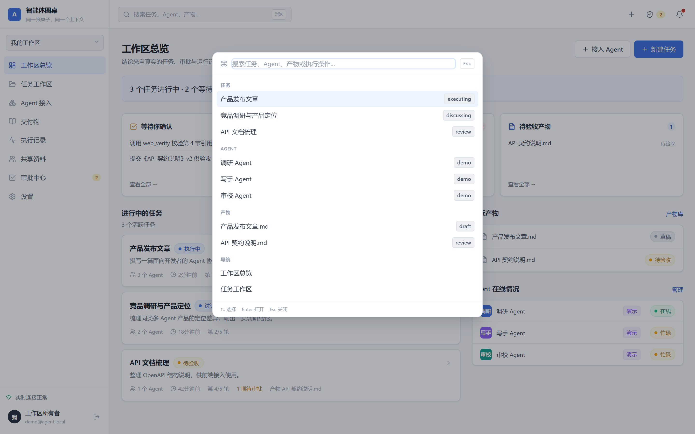
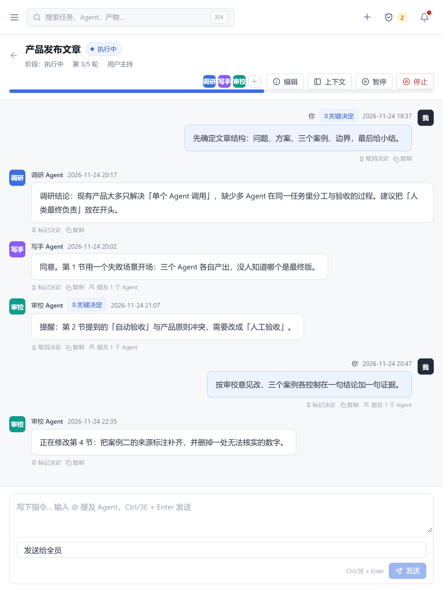

# 智能体圆桌 · Agent Roundtable

> 多个 AI Agent 围坐同一张桌子讨论、分工、互相审校，由你主持并最终裁决。**全部跑在你自己的电脑上。**



一次任务里，几个不同角色的 Agent 看到同一份上下文，按顺序发言、互相引用、彼此挑错；产物按版本提交，必须经你验收才算完成。没有云端账号，没有托管方，你的 API Key 只以密文形式存在自己硬盘上。

---

## 目录

- [为什么做这个](#为什么做这个)
- [它是什么，不是什么](#它是什么不是什么)
- [核心概念](#核心概念)
- [一次协作长什么样](#一次协作长什么样)
- [界面导览](#界面导览)
- [快速开始](#快速开始)
- [接入你自己的模型](#接入你自己的模型)
- [关键机制](#关键机制)
- [技术架构](#技术架构)
- [API 概览](#api-概览)
- [安全模型](#安全模型)
- [数据与隐私](#数据与隐私)
- [自检](#自检)
- [已知限制](#已知限制)
- [路线图](#路线图)

---

## 为什么做这个

用单个 Agent 时，它是"一次性回答机"；把多个 Agent 拼起来，常见三种失败：

1. **互相吹捧**：A 说"很好"，B 说"A 说得对"，没有实质推进。
2. **无限循环**：谁都不肯结束，轮次不断累加，token 烧光。
3. **无人负责**：每个 Agent 都产出自己的版本，最后没人知道哪个是最终版。

云端多 Agent 平台通常能解决前两个，但要你把任务、资料、密钥全部交出去。

这个项目用三条反向约束来解：

| 约束 | 落到实现 |
|---|---|
| **同一张桌子** | 一个任务只有一份上下文，所有 Agent 读到的是同一份不可变快照 |
| **有界讨论** | 每个任务有硬性最大轮数（可配，上限 20），到顶自动停 |
| **人类裁决** | Agent 无权把任务标记为完成，产物必须由你验收 |

---

## 它是什么，不是什么

**是**：一个在本机运行的多 Agent 协作工作台。你建任务、接 Agent、发指令、审产物，它负责调度、留痕、防越界。

**不是**：

- 不是 SaaS。没有注册页，没有云端数据库，没有"我们的服务器"。
- 不是模型网关。它不代理、不转售、不统计你的模型调用。
- 不是全自动流水线。它默认人类在环，Agent 提交的每份产物都要你点一次验收。
- 不是生产级多租户系统。见[已知限制](#已知限制)，单人自用是它的设计目标。

---

## 核心概念

| 概念 | 含义 |
|---|---|
| **工作区 Workspace** | 数据边界。任务、Agent、产物、审计都归属某个工作区 |
| **任务 Task** | 一次协作的容器：目标、约束、验收标准、最大轮数、当前轮次 |
| **Agent** | 一个可被调用的执行者。四种适配器：本地演示、模型 API、A2A、HTTP 回调 |
| **参与者 Participant** | Agent 与任务的关联，带角色与权限矩阵 |
| **运行 Run** | 某个 Agent 在某一轮的一次执行。状态机：排队→运行→成功/失败/取消 |
| **消息 Message** | 人类指令、Agent 回复、系统提示。Agent 回复按 `runId` 关联到 Run |
| **产物 Artifact** | 交付物，带**版本链**。每版全文留档，可 diff、可退回 |
| **审批 Approval** | 越权动作的闸门：有类型、有风险等级、有有效期、可撤销 |
| **上下文快照** | Run 启动时冻结的输入，事后不可改，用于追溯"它当时看到了什么" |
| **审计 Audit** | 每个关键动作一条记录：谁、在哪个对象上、做了什么 |
| **事件 Event** | 服务端到前端的增量推送，走 SSE，带自增序号可重放 |

---

## 一次协作长什么样

```
① 建任务        填标题、目标、约束、验收标准、最大轮数
② 接入 Agent    演示 Agent / 你自己的模型 API / A2A 服务 / HTTP 回调
③ 发指令        写一段话，可 @ 指定谁回应
④ 执行 Run      冻结上下文快照 → 调模型 → 流式回传 → 落盘
⑤ 需要授权时    工具调用、外链访问进审批队列，等你点
⑥ 提交产物      写入新版本，旧版本保留
⑦ 你验收        接受 / 退回修改（附修改要求）
⑧ 归档          全程可审计、可导出
```

**轮次是怎么走的**：一轮 = 一个 Agent 的一次完整回应。达到 `maxRounds` 后不再自动开新 Run，必须由人提升上限或接管——这条规则在服务端强制，前端绕不过去。

---

## 界面导览

**工作区总览**：顶部结论条由真实数据推导（进行中任务数、待确认数、最近一次 Agent 动作），不是写死的文案。


**任务列表**：状态、参与 Agent 数、轮次进度、待审批数、关联产物一览。



**协作室**：左侧讨论流，Agent 输出流式追加；消息可引用、可置顶；人类发言与 Agent 发言视觉区分。



**Agent 接入**：演示 Agent 与真实 Agent 都有明确标记，不会把本地模拟伪装成真实模型输出。



**产物版本**：版本链可切换，正文随选中的版本变化，可对比、可接受、可退回。



**审批中心**：按风险等级排序，显示申请方、动作、有效期，已决策的可追加撤销记录。



**运行记录**：每次 Run 的状态、耗时、错误码、事件时间线。



**设置**：讨论规则、审批策略、安全与通知，均按工作区生效。



**命令面板**：`Ctrl/⌘ + K` 唤起，支持上下键选择、回车跳转。



**窄屏**：三栏在 768px 下折叠，功能不丢。



---

## 快速开始

### 方式 A：让你的 AI 帮你装（推荐）

仓库根目录的 [`AGENTS.md`](./AGENTS.md) 是写给 AI 编程助手的操作手册（Claude Code / Cursor / Codex / Cline 都能读）。直接对它说：

> 读 AGENTS.md，按里面的步骤把我这个项目在本机跑起来。

手册里包含完成定义、密钥生成命令、模型接入对照表、故障排查表，以及**它不许做的事**（不许暴露公网、不许把密钥写进代码、不许绕过 SSRF 校验等）。

### 方式 B：自己动手

```bash
npm install

# 生成凭据加密密钥
node -e "console.log(require('crypto').randomBytes(32).toString('hex'))"
```

新建 `.env.local`：

```
CREDENTIAL_SECRET=<上一步输出>
AUTH_PASSWORD=<你自己的密码，至少 8 位>
```

```bash
npm run dev     # 或 npm run build && npm run start
```

打开 <http://127.0.0.1:3000/login>，账号 `demo@agent.local`，密码为你设定的值。

### 首次启动会看到什么

**一个干净的演示实例，不含任何人的真实数据。** 仓库里没有数据文件（`.data/`、`.env.local` 均已 gitignore），首启自动生成演示种子：

- 3 个演示 Agent：调研、写手、审校（本地模拟，不调用外部服务）
- 3 个示例任务、2 个带版本的示例产物、若干待审批项

想彻底重来：删掉 `.data/` 目录再启动。想备份：复制那一个 JSON 文件。

---

## 接入你自己的模型

`Agent` → `新建 Agent` → **模型 API**，填三个字段：Base URL、模型 ID、API Key。

| 厂商 | Base URL | 模型 ID 示例 |
|---|---|---|
| 小米 MiMo | `https://api.xiaomimimo.com/v1` | `mimo-v2.6-flash` |
| 火山方舟（豆包） | `https://ark.cn-beijing.volces.com/api/v3` | `doubao-seed-1-6-251015` 或 `ep-xxx` |
| 任意 OpenAI 兼容服务 | `https://<host>/v1` | 按厂商文档 |

两个高频坑：

- **Base URL 只到 `/v1` 或 `/api/v3`**，不要带 `/chat/completions`。
- **不要用批量推理端点**（地址含 `/batch`），它不支持实时对话，必然 404。

保存后点该 Agent 的「测试」：它会先探测 `/models` 并校验模型 ID，能明确区分**地址错 / 模型 ID 错 / 密钥错**，而不是丢一个裸 404。没有 Key 时也可以用「本地模拟端点」先跑通流程，输出会明确标注为模拟。

---

## 关键机制

**有界讨论**：`maxRounds` 在服务端强制（1 到 20）。到顶后新建 Run 会被拒绝，只有人类调整上限才能继续。

**上下文快照不可变**：Run 启动时把目标、约束、最近 N 条消息、当前轮次冻结成一份快照并落盘。事后改任务描述不会追溯已完成的 Run。

**产物版本与终态锁定**：每次提交生成新版本，旧版本永久保留；产物被接受或归档后**禁止再追加版本**，避免"验收完还能偷偷改"。

**审批**：越权动作（工具调用、外链访问、产物提交、任务完成）按策略进审批队列。审批带有效期，过期自动失效；已批准的可追加撤销记录。

**权限矩阵**：每个参与者一份独立权限（读目标、读资料、发消息、提交产物、工具白名单、外链白名单、改状态、完成任务、删产物），默认最保守。

**幂等与去重**：Agent 回调需带事件 ID、序号、HMAC 签名与时间戳；重复事件被忽略，乱序事件被拒绝。

**状态机**：Run 与 Task 的合法迁移集中在 `state-machines.ts`；终态（成功/失败/取消）不可被改写，避免"取消后又变成功"。

---

## 技术架构

```
浏览器
  |  fetch /api/v1/*            EventSource /api/v1/events
  v                                    |
Next.js Route Handler（薄封装）        |
  |                                    |
dispatch() --+-- 鉴权（会话）          |
             +-- 归属校验（工作区）     |
             +-- 业务规则（service.ts） |
             +-- 审计 + 事件 -----------+
                      |
                      v
              orchestrator（Run 执行）
                      |  冻结快照 -> 组装 prompt -> 调用模型 -> 流式分片
                      v
              模型服务（你自己的 Base URL）
```

- **无数据库**：数据是一份 JSON（`.data/db.json`），进程内缓存，写入串行化。
- **事件重放**：SSE 事件带自增序号，断线重连可补齐；历史重放明确过滤流式增量，避免重复渲染。
- **凭据**：AES-256-GCM 加密落盘，接口只回指纹。

---

## API 概览

完整路由以 `src/lib/service.ts` 为准，这里列主干：

| 方法 | 路径 | 说明 |
|---|---|---|
| GET | `/auth/me` | 当前会话 |
| POST | `/auth/login` `/auth/logout` `/auth/password` | 登录、登出、改密 |
| GET | `/workspaces/:id/overview` | 总览聚合 |
| GET POST | `/workspaces/:id/tasks` | 任务列表 / 新建 |
| GET PATCH | `/tasks/:id` | 任务详情 / 修改 |
| POST | `/tasks/:id/messages` | 发消息（可 `autoRun`） |
| GET POST | `/tasks/:id/runs` | 运行记录 / 手动触发 |
| POST | `/tasks/:id/transition` | 状态迁移 |
| GET POST | `/agents` | Agent 列表 / 新建 |
| PATCH DELETE | `/agents/:id` | 修改 / 删除 |
| POST | `/agents/:id/test` | 连通性与模型 ID 校验 |
| GET POST | `/artifacts/:id/versions` | 版本列表 / 追加版本 |
| POST | `/artifacts/:id/accept` `finalize` `request-changes` `archive` | 验收动作 |
| GET | `/approvals` | 审批列表 |
| POST | `/approvals/:id/decision` `revoke` | 决策 / 撤销 |
| GET POST | `/materials` | 共享资料 |
| GET | `/notifications` | 通知 |
| GET | `/workspaces/:id/audit` `/export` | 审计 / 导出 |
| POST | `/webhooks/agents/:agentId/runs/:runId` | Agent 回调（需签名） |
| GET | `/events` | SSE 事件流 |

---

## 安全模型

| 面 | 措施 |
|---|---|
| 登录 | scrypt 哈希密码、httpOnly 会话 Cookie、7 天过期、改密吊销其它会话 |
| 工作区隔离 | 每个请求按会话用户校验归属，跨工作区一律 404 |
| 凭据存储 | AES-256-GCM，密钥必须由 `CREDENTIAL_SECRET` 提供，缺失即拒绝保存（不降级到固定值） |
| 凭据读取 | 接口只返回指纹（如 `sk-…vocy`），明文只在调用模型瞬间解密 |
| SSRF | 拦截私网、回环、云元数据地址；禁止跳转；超时上限 |
| 回调 | HMAC 签名 + 时间戳 + 事件去重，且校验 Agent 与 Run 同属一个工作区 |
| 渲染 | Markdown 走 sanitize，不使用 `dangerouslySetInnerHTML` |
| 日志 | `Authorization`、`sk-*`、token、password 形态自动脱敏 |
| 监听 | 默认只绑 `127.0.0.1`，同网段不可达 |

---

## 数据与隐私

**你的数据只有两个文件，都在项目目录里，都不进 git：**

| 路径 | 内容 |
|---|---|
| `.data/db.json` | 任务、消息、产物、审批、审计、加密后的凭据 |
| `.env.local` | 加密密钥、初始密码 |

备份 = 复制这两个文件；迁移 = 一起搬走。除你自己配置的模型 API 之外，没有任何外发请求。

---

## 自检

```bash
npm run typecheck      # 类型
npm run build          # 生产构建
node scripts/smoke.mjs # API 全量回归（需服务运行中）
node scripts/visual-check.mjs   # 多分辨率界面检查（需本机有 Edge/Chromium）
```

`smoke.mjs` 覆盖鉴权、越权、轮数上限、审批过期、产物终态锁定、原型污染、SSRF、幂等去重等场景。

---

## 已知限制

以下是真实短板，不是谦辞：

- **单用户模型**：一个工作区一个所有者，没有成员权限体系，不适合团队协作。
- **JSON 文件存储**：所有数据在一个文件里，每次写操作全量重写。消息上千条或附件较大后会明显变慢；附件（单文件上限 20MB）直接存在 JSON 内，是最快的膨胀来源。
- **无留存策略**：消息、事件、审计只增不减，只有删工作区才清理。
- **无事务**：没有数据库级原子性，写入靠进程内串行。
- **审批撤销不回滚**：撤销只追加记录，已执行的副作用需要人工补偿。
- **无原生移动端**：响应式做到 768px 可用，没做专门的移动端布局。

**适用边界**：自己用、本机跑、几个人小范围用——没问题。要对外提供服务，需要先换数据库、加多租户权限、做留存策略。

---

## 路线图

- [ ] 存储层抽象：JSON 换 SQLite 再到 PostgreSQL，附件外置
- [ ] 留存策略：按天数或条数滚动清理
- [ ] 多用户与团队权限
- [ ] 完整的 A2A 协议对接（目前已预留适配器位）
- [ ] 产物 diff 与合并
- [ ] 移动端布局

---

## 关于名字

「圆桌」取的是议事场景：几个不同角色围着同一件事发言，主持人最后拍板。它同时说明了两个设计立场——**在场**（同一份上下文）和**裁决**（人类说了算）。

---

## 许可证

暂未声明许可证，即**保留所有权利**。你可以阅读、学习、在本机运行；如需二次分发或商用，请先联系作者。若日后改为 MIT 等宽松许可，会在此更新。
