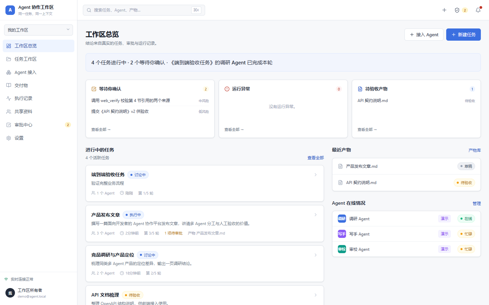

# Agent 协作工作区

一个**完全跑在你自己电脑上**的多 Agent 协作平台：多个 AI Agent 围绕同一个任务讨论、分工、修改，由你最终验收。没有云端账号，没有厂商绑定，你的 API Key 只存在本机。



## 它解决什么问题

多 Agent 协作通常意味着把任务、资料、密钥交给某个云平台。这个项目反过来：**代码在你机器上，数据在你的硬盘上，密钥用你本地的随机密钥加密**。你唯一需要联网的时刻，是 Agent 调用你自己配置的模型 API。

- **有界讨论**：每个任务有最大轮数上限，Agent 不会无限互相吹捧
- **人类最终验收**：产物必须由你验收，Agent 不能自己宣布完成
- **可追溯**：每次状态变化、每次工具调用都进审计日志
- **产物版本**：每版全文留档，可对比、可退回修改
- **实时可见**：Agent 输出通过 SSE 流式推送到界面

---

## 三种开始方式

### 方式 A：让你的 AI 帮你装（推荐）

本项目附带了写给 AI 编程助手的操作手册 [`AGENTS.md`](./AGENTS.md)。把仓库交给 Claude Code / Cursor / Codex / Cline 等工具，直接说：

> 读 AGENTS.md，按里面的步骤把我这个项目在本机跑起来。

它会按手册完成依赖安装、密钥生成、环境变量配置、启动、自检，并在最后给你一份验收清单。手册里还写明了**它不许做的事**（不许把服务暴露到公网、不许把密钥写进代码、不许破坏 SSRF 防护等）。

### 方式 B：自己动手（三条命令）

```bash
npm install
node -e "console.log(require('crypto').randomBytes(32).toString('hex'))"   # 生成加密密钥
```

新建 `.env.local`，填入：

```
CREDENTIAL_SECRET=<上一步输出>
AUTH_PASSWORD=<你自己的密码，至少 8 位>
```

```bash
npm run dev
```

打开 <http://127.0.0.1:3000/login>，用 `demo@agent.local` + 你设的密码登录。

### 方式 C：只想先看看界面

不需要任何配置。`npm run dev` 后登录，内置的演示 Agent 走本地模拟端点，**不调用任何外部服务、不需要 Key**，回复会明确标注「本地模拟」。看清楚流程后再决定要不要接真实模型。

---

## 接入你自己的模型

界面路径：`Agent` → `新建 Agent` → **模型 API**。三个输入框：Base URL、模型 ID、API Key。

| 厂商 | Base URL | 模型 ID 示例 |
|---|---|---|
| 小米 MiMo | `https://api.xiaomimimo.com/v1` | `mimo-v2.6-flash` |
| 火山方舟（豆包） | `https://ark.cn-beijing.volces.com/api/v3` | `doubao-seed-1-6-251015` |
| 其它 OpenAI 兼容服务 | `https://<host>/v1` | 按厂商文档 |

两个高频坑：

- **Base URL 不要带 `/chat/completions`**，只到 `/v1` 或 `/api/v3`
- **不要用批量推理端点**（地址含 `/batch`）——它不支持实时对话，会直接 404

保存后可以点该 Agent 的「测试」：它会先探测 `/models` 并校验模型 ID，能明确区分是**地址错、模型 ID 错还是 Key 错**，而不是只丢一个裸 404。

---

## 安全设计

| 项 | 做法 |
|---|---|
| 密钥存储 | AES-256-GCM 加密后落盘，接口只返回指纹（如 `sk-…vocy`），永不回显明文 |
| 加密密钥 | 必须由你通过 `CREDENTIAL_SECRET` 提供，缺失时**拒绝保存凭据**（503），不降级到固定值 |
| 登录 | scrypt 哈希密码 + httpOnly 会话 Cookie（SameSite=Lax，7 天过期），改密吊销其它会话 |
| 监听地址 | 默认只绑 `127.0.0.1`，同网段其它机器无法访问 |
| 外链防护 | SSRF 校验拦截私网、回环、云元数据地址，禁止跳转，超时限制 |
| 日志 | Authorization、`sk-*`、token 等形态自动脱敏 |
| 渲染 | Agent 输出走 Markdown + sanitize，不用 `dangerouslySetInnerHTML` |
| 回调 | webhook 需 HMAC 签名 + 时间戳 + 事件去重，且必须携带有效 `CREDENTIAL_SECRET` |

---

## 已知限制（请先读这一段再决定用途）

这个项目是**单人本地工具**，不是多租户 SaaS。以下是真实短板，不是谦虚：

- **单用户模型**：数据层按"一个工作区一个所有者"设计，没有团队/成员权限体系。
- **JSON 文件存储**：所有数据在一个 `.data/db.json` 里，每次写操作全量重写。**数据量上千条消息或几个大附件后会明显变慢**；附件（单文件上限 20MB）直接存在 JSON 内，是最快的膨胀来源。
- **无留存/清理策略**：消息、事件、审计只增不减，只有删工作区才清理。
- **无数据库**：没有事务、没有并发控制、没有备份机制，备份就是复制那个 JSON 文件。
- **审批撤销不回滚副作用**：撤销只追加一条记录，已执行的操作不会自动补偿。
- **无原生移动端**：响应式做到了 768px 可用，但没做专门的移动端布局。

**结论**：自己用、几个人用、本机跑——没问题。要部署给外部用户长期使用，需要先把存储换成数据库、加上留存策略和真正的多租户权限。

---

## 项目结构

```
src/
  app/api/v1/[[...path]]/route.ts   API 入口（薄封装，逻辑在 service.ts）
  app/api/v1/events/route.ts        SSE 事件流
  lib/
    service.ts        路由分发、鉴权、业务规则（核心）
    orchestrator.ts   Run 执行、流式输出、失败处理
    auth.ts           密码哈希、会话、Cookie
    security.ts       加密、SSRF 校验、脱敏、文件名校验
    state-machines.ts 状态迁移约束
    db.ts             数据加载/持久化
    events.ts         事件总线与重放
  components/views/   七个主视图
scripts/
  smoke.mjs         API 全量回归（含安全用例）
  visual-check.mjs  多分辨率界面检查
  redact-check.mjs  日志脱敏验证
AGENTS.md           给 AI 编程助手的部署手册
```

---

## 自检

```bash
npm run typecheck
npm run build
node scripts/smoke.mjs        # 需服务运行中，且提供 CREDENTIAL_SECRET / AUTH_PASSWORD
```

---

## 许可证

暂未声明许可证。如果你希望别人能合法地使用、修改、分发这份代码，建议加一个（MIT 最宽松）。在声明之前，默认保留所有权利——别人可以看，但严格来说不能直接用。使用前请自行判断并承担相应责任。
